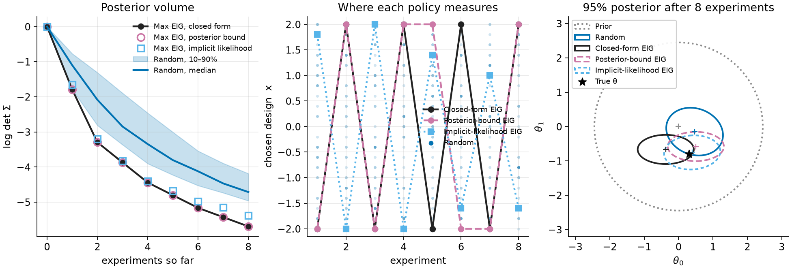

# boed-pytorch

Variational estimators of expected information gain (EIG) from Foster, Jankowiak, Bingham, Chen, and Goodman, [Variational Bayesian Optimal Experimental Design](https://arxiv.org/abs/1903.05480) (NeurIPS 2019). The EIG of a design is the mutual information between a latent parameter and the outcome of the experiment, so the Bayesian optimal design is the one with the largest EIG. Nested Monte Carlo estimates that mutual information with an inner loop and is biased high until the inner sample count is large. A variational posterior gives a lower bound, a variational marginal gives an upper bound, and variational nested Monte Carlo (VNMC) draws the inner samples from a learned posterior proposal, so the estimate reaches the truth with far fewer samples. The implicit-likelihood estimator learns a stand-in for both the likelihood and the marginal, which is what lets the same contrast run when the likelihood cannot be evaluated. The scripts in `src/` are the original 2020 design-optimization experiments. The showcase below is a conjugate Bayesian linear regression, where the EIG has a closed form, and it runs on CPU in about twelve seconds.

## Math

For a Gaussian prior and a Gaussian linear likelihood, \(\theta \sim \mathcal{N}(\mu, \Sigma)\) and \(y \mid \theta, X \sim \mathcal{N}(X\theta, \sigma^2 I)\),

$$
\mathrm{EIG}(X) = \frac{1}{2} \log\det\left(I + \frac{X \Sigma X^\top}{\sigma^2}\right).
$$

The showcase takes one scalar design \(x\) with feature row \([1,\; x]\), prior \(\Sigma = I\), and noise \(\sigma = 1\). Then \(\mathrm{EIG}(x) = \tfrac{1}{2}\log(2 + x^2)\). At \(x = 1.5\) the value is **0.723 nats**; it is smallest at \(x = 0\) (0.347) and largest at the endpoints \(x = \pm 2\) (0.896).

The estimators, with \(q_\phi\) a small Gaussian network, are

$$
\begin{aligned}
\mathcal{L}_{\mathrm{post}}
  &= \mathbb{E}\big[\log q_\phi(\theta \mid y, x) - \log p(\theta)\big]
  &&\le \mathrm{EIG}, \\
\mathcal{U}_{\mathrm{marg}}
  &= \mathbb{E}\big[\log p(y \mid \theta, x) - \log q_\phi(y \mid x)\big]
  &&\ge \mathrm{EIG}, \\
\mathcal{U}_{\mathrm{VNMC}}
  &= \mathbb{E}\Big[\log p(y \mid \theta_0, x)
     - \log \frac{1}{L}\sum_{\ell=1}^{L}
       \frac{p(y \mid \theta_\ell, x)\, p(\theta_\ell)}{q_\phi(\theta_\ell \mid y, x)}\Big], \\
\mathcal{I}_{\mathrm{m}+\ell}
  &= \mathbb{E}\big[\log q_\ell(y \mid \theta, x) - \log q_m(y \mid x)\big].
\end{aligned}
$$

Nested Monte Carlo is the VNMC contrast with the inner parameters drawn from the prior. \(\mathcal{I}_{\mathrm{m}+\ell}\) is the implicit-likelihood estimator from `src/vimp.py`: both networks are trained by maximum likelihood, and the contrast can fall on either side of the EIG.

## Run

```bash
pip install -r requirements.txt && python -m showcase.run_showcase
```

Seed 0. The command rewrites the figures in `assets/` and `assets/results.json`. Smoke test: `python -m pytest`.

The original Laplace-prior design loops are separate, and longer: `python -m src.vpost --steps 100` (also `vmarg`, `vnmc`, `vimp`).

## Figures

On 25 designs in \([-2, 2]\), against the closed form:

| Estimator | Mean error | Max \|error\| |
| --- | ---: | ---: |
| Posterior lower bound | −0.003 | 0.023 |
| Marginal upper bound | +0.001 | 0.014 |
| VNMC | +0.006 | 0.032 |
| Implicit likelihood | −0.006 | 0.032 |
| Nested Monte Carlo (M = 96) | +0.008 | 0.042 |

The implicit-likelihood errors change sign. Its mean sits 0.006 nats below the closed form, and the largest miss on the grid is 0.032. The posterior and marginal means keep the sign of their bounds, and the nested Monte Carlo mean stays positive.


At the reference design \(x = 1.5\), the posterior bound climbs from 0 and the marginal bound falls from about 1.65. The implicit-likelihood estimate also starts at 0, because both networks begin as the same \(\mathcal{N}(0, 1)\) and the ratio is one, then crosses the closed form and finishes at **0.710** against 0.723. With one inner sample, nested Monte Carlo reads **3.21** against the truth 0.723; VNMC reads **0.90**. By 16 inner samples VNMC is at **0.726** while nested Monte Carlo is still at **0.820**.


Eight myopic experiments, candidates on a grid in \([-2, 2]\). Maximizing the closed form or the posterior bound alternates the two endpoints. Once the posterior is symmetric the two endpoints have the same EIG, so the posterior bound sometimes swaps them and the covariance is unchanged. The implicit-likelihood policy starts near those endpoints and later steps inward: the ratio of two learned densities ranks neighboring designs less sharply once the posterior has shrunk. Final \(\log\det\Sigma\): **−5.69** for the closed form and the posterior bound, **−5.38** for the implicit-likelihood policy, **−4.71** for the median of 40 random policies. The endpoint policies leave a determinant about 2.7 times smaller than that random median; the implicit-likelihood policy leaves it about 1.9 times smaller.



## Layout

| Path | What it is |
| --- | --- |
| `src/vpost.py` | Variational posterior lower bound, and gradient ascent on the design |
| `src/vmarg.py` | Variational marginal upper bound |
| `src/vnmc.py` | Variational nested Monte Carlo |
| `src/vimp.py` | Implicit-likelihood estimator, with an optional implicit-gradient term |
| `showcase/model.py` | Conjugate linear regression and the closed-form EIG |
| `showcase/estimators.py` | Posterior, marginal, VNMC, implicit likelihood, and nested Monte Carlo |
| `showcase/run_showcase.py` | The three figures |
