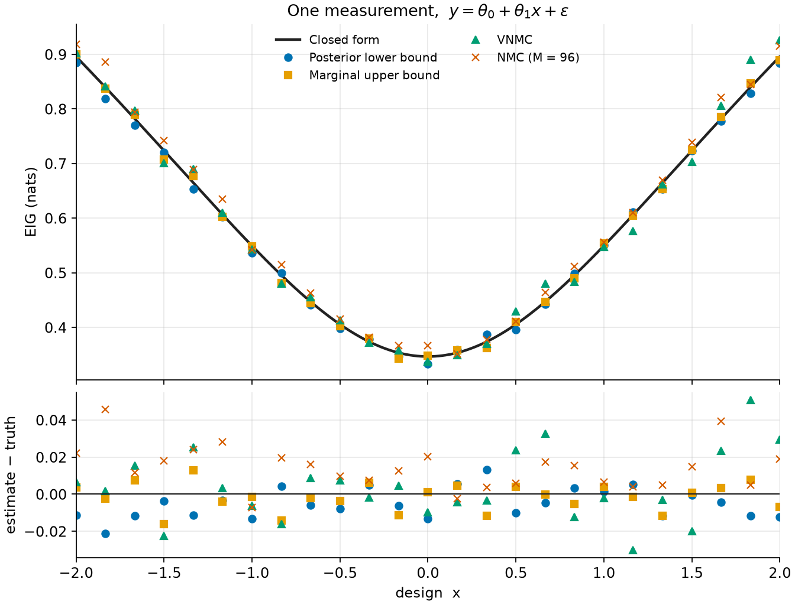
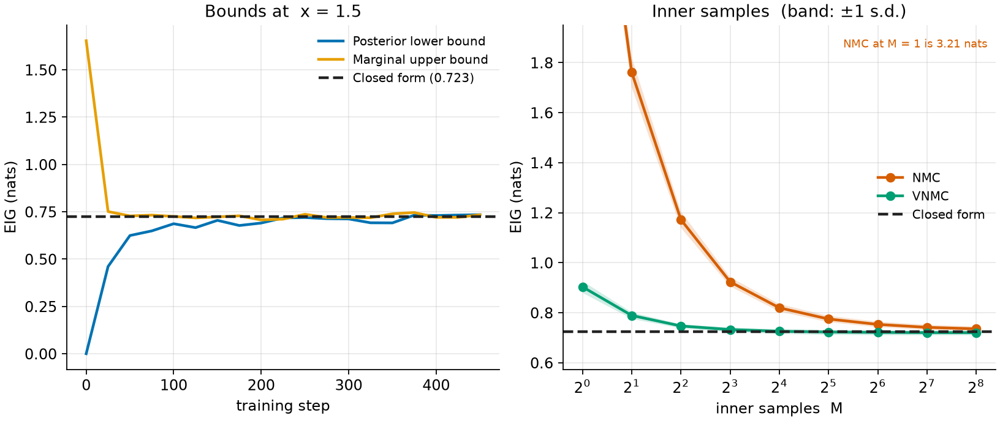

# boed-pytorch

Variational estimators of expected information gain (EIG) from Foster, Jankowiak, Bingham, Chen, and Goodman, [Variational Bayesian Optimal Experimental Design](https://arxiv.org/abs/1903.05480) (NeurIPS 2019). The EIG of a design is the mutual information between a latent parameter and the outcome of the experiment, so the Bayesian optimal design is the one with the largest EIG. Nested Monte Carlo estimates that mutual information with an inner loop and is biased high until the inner sample count is large. A variational posterior gives a lower bound, a variational marginal gives an upper bound, and variational nested Monte Carlo (VNMC) draws the inner samples from a learned posterior proposal, so the estimate reaches the truth with far fewer samples. The scripts in `src/` are the original 2020 design-optimization experiments. The showcase below is a conjugate Bayesian linear regression, where the EIG has a closed form, and it runs on CPU in about ten seconds.

## Math

For a Gaussian prior and a Gaussian linear likelihood, \(\theta \sim \mathcal{N}(\mu, \Sigma)\) and \(y \mid \theta, X \sim \mathcal{N}(X\theta, \sigma^2 I)\),

$$
\mathrm{EIG}(X) = \frac{1}{2} \log\det\left(I + \frac{X \Sigma X^\top}{\sigma^2}\right).
$$

The showcase takes one scalar design \(x\) with feature row \([1,\; x]\), prior \(\Sigma = I\), and noise \(\sigma = 1\). Then \(\mathrm{EIG}(x) = \tfrac{1}{2}\log(2 + x^2)\). At \(x = 1.5\) the value is **0.723 nats**; it is smallest at \(x = 0\) (0.347) and largest at the endpoints \(x = \pm 2\) (0.896).

The estimators, with \(q_\phi\) a small Gaussian network, are

$$
\begin{aligned}
\mathcal{L}_{\mathrm{post}}
  &= \mathbb{E}\big[\log q_\phi(\theta \mid y, x) - \log p(\theta)\big]
  &&\le \mathrm{EIG}, \\
\mathcal{U}_{\mathrm{marg}}
  &= \mathbb{E}\big[\log p(y \mid \theta, x) - \log q_\phi(y \mid x)\big]
  &&\ge \mathrm{EIG}, \\
\mathcal{U}_{\mathrm{VNMC}}
  &= \mathbb{E}\Big[\log p(y \mid \theta_0, x)
     - \log \frac{1}{L}\sum_{\ell=1}^{L}
       \frac{p(y \mid \theta_\ell, x)\, p(\theta_\ell)}{q_\phi(\theta_\ell \mid y, x)}\Big].
\end{aligned}
$$

Nested Monte Carlo is the same contrast as VNMC with the inner parameters drawn from the prior. `src/vimp.py` is the paper's implicit-likelihood estimator \(\mathbb{E}[\log q_\ell(y \mid \theta, x) - \log q_m(y \mid x)]\), for simulators whose likelihood cannot be evaluated.

## Run

```bash
pip install -r requirements.txt && python -m showcase.run_showcase
```

Seed 0. The command rewrites the figures in `assets/` and `assets/results.json`. Smoke test: `python -m pytest`.

The original Laplace-prior design loops are separate, and longer: `python -m src.vpost --steps 100` (also `vmarg`, `vnmc`, `vimp`).

## Figures

On 25 designs in \([-2, 2]\), the posterior lower bound stays within **0.021 nats** of the closed form (mean error −0.005) and the marginal upper bound within **0.016** (mean error −0.001). VNMC has mean error +0.004. Nested Monte Carlo with 96 inner samples sits **0.015 nats** above the closed form on average.



At the reference design \(x = 1.5\), the posterior bound climbs from 0 and the marginal bound falls from about 1.65, and both finish on the closed form 0.723. With one inner sample, nested Monte Carlo reads **3.21** against the truth 0.723; VNMC reads **0.90**. By 16 inner samples VNMC is at **0.726** while nested Monte Carlo is still at **0.820**.



Eight myopic experiments, candidates on a grid in \([-2, 2]\). Maximizing EIG, either in closed form or with the posterior bound, alternates the two endpoints. Once the posterior is symmetric the two endpoints have the same EIG, so the learned bound sometimes swaps them and the covariance is unchanged. Final \(\log\det\Sigma\): **−5.69** for both EIG policies, **−4.71** for the median of 40 random policies. The determinant of the EIG posterior is about 2.7 times smaller.


## Layout

| Path | What it is |
| --- | --- |
| `src/vpost.py` | Variational posterior lower bound, and gradient ascent on the design |
| `src/vmarg.py` | Variational marginal upper bound |
| `src/vnmc.py` | Variational nested Monte Carlo |
| `src/vimp.py` | Implicit-likelihood estimator, with an optional implicit-gradient term |
| `showcase/model.py` | Conjugate linear regression and the closed-form EIG |
| `showcase/estimators.py` | Posterior, marginal, VNMC, and nested Monte Carlo |
| `showcase/run_showcase.py` | The three figures |
